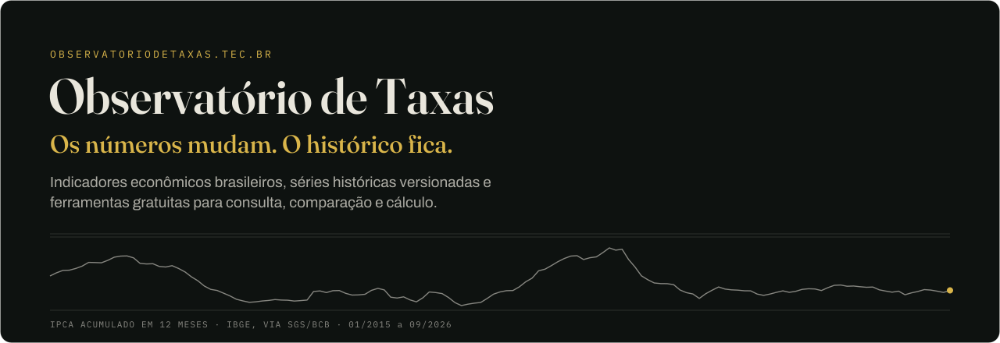
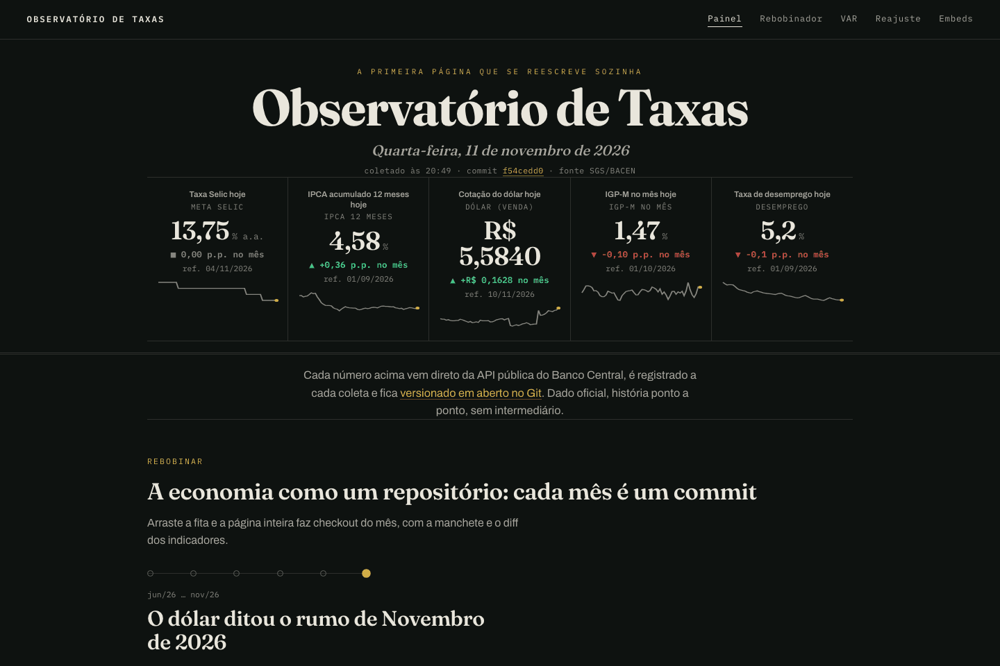
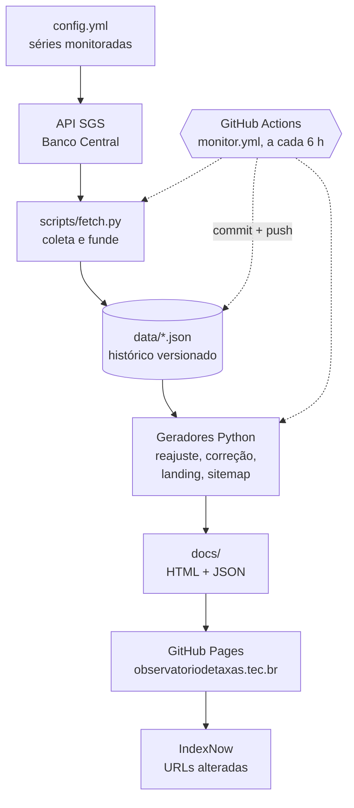

<p align="center">
  <a href="https://observatoriodetaxas.tec.br/"></a>
</p>

<p align="center">
  <a href="https://observatoriodetaxas.tec.br/"><b>Site</b></a> ·
  <a href="https://observatoriodetaxas.tec.br/reajuste/">Reajuste</a> ·
  <a href="https://observatoriodetaxas.tec.br/correcao/">Correção monetária</a> ·
  <a href="https://observatoriodetaxas.tec.br/var.html">VAR</a> ·
  <a href="https://observatoriodetaxas.tec.br/data/series.json">Dados (JSON)</a> ·
  <a href="desenvolvimento/GUIA.md">Guia do desenvolvedor</a> ·
  <a href="https://observatoriodetaxas.tec.br/apoie/">Apoie</a>
</p>

O Observatório de Taxas publica indicadores econômicos do Brasil (Selic,
IPCA, INPC, IGP-M, câmbio, desemprego e outros) com o histórico completo de
cada número. Um robô coleta as séries a cada 6 horas e grava cada mudança como
um commit neste repositório. O site é estático, gratuito e sem cadastro.

## Conheça o Observatório

Quem precisa reajustar um aluguel, corrigir um valor ou conferir uma
afirmação sobre a economia costuma encontrar o número do mês, mas não o
caminho até ele: de onde veio, quando mudou, como foi calculado.

O Observatório guarda esse caminho:

- **Dados oficiais.** Os números vêm da API pública do SGS (Sistema
  Gerenciador de Séries Temporais) do Banco Central, que distribui séries
  próprias e de outros órgãos. Cada página diz quem produz o índice.
- **Histórico versionado.** Cada coleta que muda algum valor vira um commit.
  O histórico do Git é a linha do tempo de cada indicador, e qualquer número
  publicado pode ser conferido no ponto exato em que entrou.
- **Disponível em três formas.** Páginas em HTML (legíveis sem JavaScript),
  arquivos JSON em `/data/` e gráficos para incorporar em outros sites.
- **Independente e gratuito.** Sem servidor, sem banco de dados, sem anúncios.
  Projeto mantido pela LBP Tecnologia.

## Ferramentas

| Ferramenta | O que faz | Link |
| --- | --- | --- |
| Painel | Os números do dia (Selic, IPCA 12 meses, dólar, IGP-M, desemprego) com variação no mês | [observatoriodetaxas.tec.br](https://observatoriodetaxas.tec.br/) |
| Reajuste de contratos | Acumulado de 12 meses, fator e calculadora por índice e mês: uma página para cada mês desde dezembro de 2015 | [/reajuste/](https://observatoriodetaxas.tec.br/reajuste/) |
| Correção monetária | Atualiza um valor entre duas datas pelo IPCA, IGP-M, INPC ou IGP-DI | [/correcao/](https://observatoriodetaxas.tec.br/correcao/) |
| Rebobinar | A economia mês a mês, como uma linha do tempo de commits | [/rebobinar.html](https://observatoriodetaxas.tec.br/rebobinar.html) |
| VAR da Economia | Confere uma afirmação comparando dois períodos de uma série e emite um recibo com link permanente | [/var.html](https://observatoriodetaxas.tec.br/var.html) |
| Retransmissora | Gera o código para incorporar um gráfico que se atualiza sozinho | [/retransmissora.html](https://observatoriodetaxas.tec.br/retransmissora.html) |
| Dados abertos | Séries em JSON e manifesto de todas as séries | [/data/series.json](https://observatoriodetaxas.tec.br/data/series.json) |

## Interface

<p align="center">
  
</p>
<p align="center"><sub>Página inicial em 11/11/2026, capturada do site publicado.</sub></p>

## Arquitetura



Três camadas, com papéis diferentes:

| Camada | Onde | O que é |
| --- | --- | --- |
| Origem oficial | API do SGS | O dado como o Banco Central distribui. O Observatório não altera os valores. |
| Histórico versionado | `data/` | Um arquivo por série, fundido por data a cada coleta. É o armazenamento canônico. |
| Arquivos gerados | `docs/` | Páginas HTML, espelho dos JSONs e sitemap, reescritos a partir de `data/`. É o que o GitHub Pages publica. |

**Git como histórico temporal.** O `monitor.yml` só commita quando algum
arquivo muda, e os arquivos de `data/` só mudam quando o SGS traz valor novo
ou revisado. Assim, `git log -- data/189_history.json` mostra quando cada ponto
do IGP-M foi coletado ou revisado, e uma tag (`v1.4.0`, `v1.5.0`…) fixa o
estado de todas as séries numa data.

**Depois da publicação**, o `indexnow.yml` avisa os buscadores apenas das
URLs que mudaram, conferindo antes que o Pages já serve a versão nova
(primeira execução manual; ver [`organic-discovery/INDEXNOW.md`](organic-discovery/INDEXNOW.md)).

## Dados e metodologia

| Índice | Produzido por | Série no SGS |
| --- | --- | --- |
| IPCA (mensal e 12 meses) | IBGE | 433, 13522 |
| INPC | IBGE | 188 |
| Taxa de desocupação (PNAD Contínua) | IBGE | 24369 |
| IGP-M, IGP-DI | FGV IBRE | 189, 190 |
| Meta Selic, Selic anualizada, Selic acumulada no mês | Banco Central | 432, 1178, 4390 |
| TR, poupança (depósitos até 03/05/2012) | Banco Central | 226, 25 |
| Câmbio USD/BRL e EUR/BRL, IBC-Br | Banco Central | 1, 10813, 21619, 24363 |

O SGS do Banco Central distribui todas essas séries, mas o Banco Central não
produz o IPCA, o INPC, o IGP-M nem o IGP-DI.

**Acumulados.** O acumulado de um período é composto, não somado:

```
acumulado = (1 + i₁/100) × (1 + i₂/100) × … × (1 + iₙ/100) − 1
```

O reajuste de 12 meses usa as 12 variações até o mês de referência
([`acumulado`](scripts/build_pages.py) em `scripts/build_pages.py`). A
correção entre datas aplica as variações dos meses posteriores ao inicial até
o final ([`fator_periodo`](scripts/build_correcao.py) em
`scripts/build_correcao.py`). Os testes em [`tests/`](tests/) conferem a
fórmula contra a série oficial do IPCA 12 meses (SGS 13522) e garantem que os
valores publicados não mudam sem querer.

## Executando localmente

Requer Python 3.12 ou superior (o workflow usa 3.12).

```bash
git clone https://github.com/iosbilario/observatorio-taxas.git
cd observatorio-taxas
python -m venv .venv
source .venv/bin/activate                 # Windows: .venv\Scripts\activate
pip install --require-hashes -r requirements.txt
```

```bash
python scripts/backfill.py                # opcional, uma vez: histórico desde 2015 (ou: backfill.py 2019)
python scripts/fetch.py                   # coleta os pontos novos em data/ e docs/data/
python scripts/build_pages.py             # páginas de reajuste
python scripts/build_correcao.py          # páginas de correção
python scripts/render_index.py            # boletim da página inicial + sitemap
python scripts/sync_nav.py                # header em todas as páginas
python scripts/csp_hashes.py              # hashes da CSP
python -m unittest discover -s tests -v   # testes
python -m http.server 8000 --bind 127.0.0.1 --directory docs
```

Abra `http://127.0.0.1:8000`. Detalhes de cada script, da estrutura de pastas
e da configuração das séries estão no [Guia do desenvolvedor](desenvolvimento/GUIA.md).

## Automações

| Workflow | Quando roda | O que faz |
| --- | --- | --- |
| [`monitor.yml`](.github/workflows/monitor.yml) | A cada 6 horas e sob demanda | Coleta as séries, gera as páginas, atualiza CSP e card social, e commita só se algo mudou |
| [`validate.yml`](.github/workflows/validate.yml) | Em pull requests | Roda os testes, regenera as páginas e confere que o resultado é igual ao commitado. Não toca na coleta |
| [`indexnow.yml`](.github/workflows/indexnow.yml) | Depois do monitor, em push na `main` e a cada 6 horas | Avisa os buscadores só das URLs alteradas, depois do deploy. Aguarda a primeira execução manual |

O status de cada execução fica na aba [Actions](https://github.com/iosbilario/observatorio-taxas/actions).

## Como contribuir

- **Dado errado ou rótulo impreciso:** abra uma [issue](https://github.com/iosbilario/observatorio-taxas/issues)
  com a URL da página, a série (código SGS) e a fonte oficial que mostra o valor correto.
- **Problema no site:** [issue](https://github.com/iosbilario/observatorio-taxas/issues) com o endereço,
  o navegador e o que aconteceu.
- **Código:** abra um [pull request](https://github.com/iosbilario/observatorio-taxas/pulls).
  Altere os geradores em `scripts/` (não o HTML gerado em `docs/reajuste/` e
  `docs/correcao/`), rode o pipeline e os testes, e commite o resultado. O
  `validate.yml` confere isso no PR.
- **Segurança:** veja [`SECURITY.md`](SECURITY.md).

## Como citar e reutilizar

- **Citação:** botão *Cite this repository* do GitHub, a partir do [`CITATION.cff`](CITATION.cff).
  Cite também o produtor do índice (IBGE, FGV IBRE ou Banco Central).
- **Referência permanente a um dado:** use a versão. Ex.: IGP-M mensal como publicado na v1.4.0:
  [`blob/v1.4.0/data/189_history.json`](https://github.com/iosbilario/observatorio-taxas/blob/v1.4.0/data/189_history.json).
  A URL do site (`/data/189_history.json`) é sempre a versão mais recente.
- **Ponto no tempo exato:** cada coleta é um commit; o recibo do VAR traz o commit usado.

| O quê | Licença |
| --- | --- |
| Código | MIT ([`LICENSE`](LICENSE)) |
| Séries do Banco Central | ODbL 1.0, com atribuição ([`LICENSE-DADOS.md`](LICENSE-DADOS.md)) |
| IPCA, INPC, desocupação (IBGE), IGP-M, IGP-DI (FGV IBRE) | Termos dos produtores; não são relicenciadas ([`LICENSE-DADOS.md`](LICENSE-DADOS.md)) |
| Textos do site | CC BY 4.0, com atribuição |

## Apoie o projeto

O Observatório é gratuito e continua gratuito. Se ele foi útil para você, uma
contribuição voluntária ajuda a manter a coleta, a infraestrutura e as
ferramentas: [observatoriodetaxas.tec.br/apoie](https://observatoriodetaxas.tec.br/apoie/).

---

<sub>Observatório de Taxas · LBP Tecnologia · Conteúdo informativo, sem caráter de recomendação financeira.</sub>
